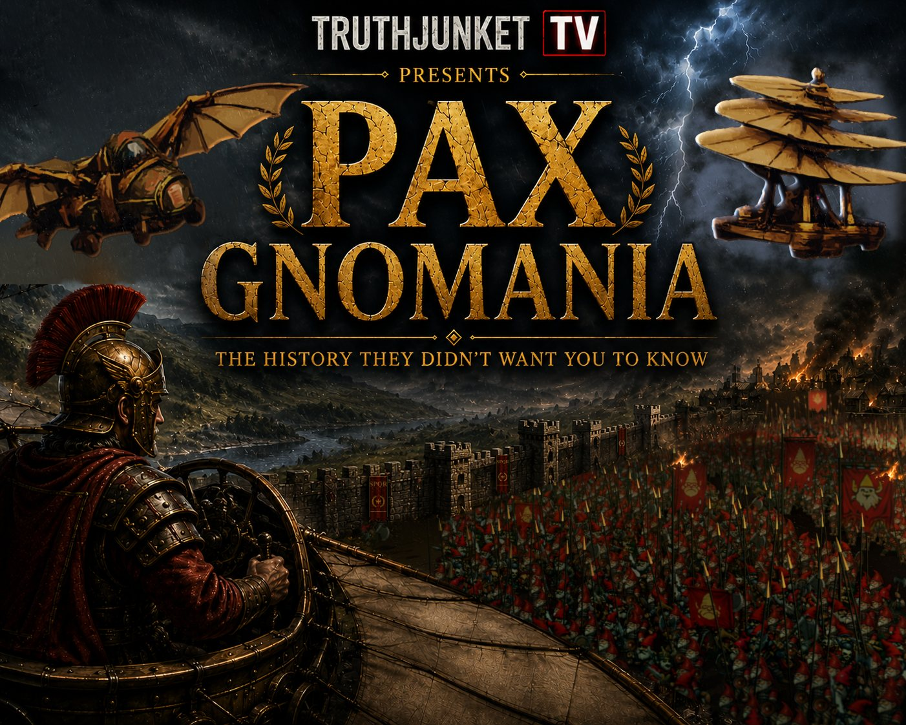

## ▶ [PLAY IT IN YOUR BROWSER][play]

**Status:** playable, not finished. All sixteen fronts of the march play start to finish, from Dover to the top of the Wall. The duel on the summit is still to be built.

*A TruthJunket TV special.*

Britannia, AD 122. For two hundred years, historians tell us, Rome enjoyed
peace. Historians credit the legions.

**Dr. H. Wolfe** has other ideas.

Tonight on TruthJunket TV, the occult historian of Peter University follows the
record no one was supposed to keep: Hadrian's secret **Ornithopter Corps**,
bronze flying machines built by gnome engineers, and the night the **Red Hat
Legion** came up the white cliffs at Dover. It was the end of the Peace. It went
all the way to the Wall.

*"They had flight in AD 122. We do not. Are we, in fact, going backwards?"*

---

A Castle Killscreen arcade game by Anders & Partners LLC. Free, in your
browser, nothing to install, and nothing leaves the page: no fonts, no
trackers, no outside servers.

You fly an ornithopter above a war you can't win. The Red Hat Legion advances
underneath you and everybody it catches is left behind: villagers, Roman
legionaries, gnome engineers, the garrison goats. You can't stop the war. You
can bring people out of it, one at a time, on the end of a rope.

## How to play

Fly **low** and the end of your rope reaches the stranded. Pass it to their
hands and they grab on and hang. Carry them to the **SAFE** flag (the camp, the
stockade, the ridge, the milecastle) and set them down low. The rope holds one.
Bring out enough before the horn and the front is held.

- **THE RAY**: hold it over a red hat and a beam of light lifts him out of the
  fight. You hover while it works.
- **THE SCREW**: tap it and the ornithopter folds into the bronze aerial screw.
  Fire passes through you and bolts bounce off. It has a short cooldown.
- **LADDER CRATES** drift in now and then. The ladder carries three, and they
  climb up while you hold still. Goats won't climb, so they go on the rope.
- **Every danger warns you first.** A dotted aim line turns **red** before the
  ballista fires. A red lane flashes before a taken thopter crosses it. A ring
  marks where the catapult stone will land.
- **A hit** costs hull, and whoever is on your rope lets go. A short drop they
  walk off. A long fall, they're lost. Three hits and you're shot down.

### Controls

| | Keyboard | Controller |
|---|---|---|
| Fly | arrows or **WASD** | stick / D-pad |
| THE RAY (hold) | **SPACE** or **Z** | **A** or **RT** |
| THE SCREW | **F**, **X** or **SHIFT** | **B**, **X** or **LT** |
| Start / confirm | **SPACE** or **ENTER** | **A** / **START** |
| Retry the front | **R** | **A** on the retry screen |
| Back to the title | **ESC** | **SELECT** |
| Sound on/off | **M** | |

On the front map, **1** to **9** jump straight to the first nine fronts, in march order.
There is no pause yet: **ESC** during a front goes back to the title.

The game is laid out for a computer screen, 16:9.

## The fronts

The campaign follows the Legion's march from Dover to Hadrian's Wall, sixteen
fronts in all. Every front is a mission of three or four phases, and you can
fly it for Rome or, from the far side, for the gnomes.

**The fall of Britannia**

1. **THE FALL OF DOVER**: dawn on the white cliffs, the tutorial.
2. **NOTTINGHAM HOODS**: travellers under the Sherwood canopy, and the Hoods,
   who shoot at anything in the sky.
3. **LONDON CALLING**: night on the Thames bridge, choked with civilians, while
   the press of the crowd pushes anyone it reaches into the river.
4. **LONDON PROPER**: the forum burning, people waiting on the roofs.
5. **THE WHITE HORSE VALE**: the host catches the Legion in the open under the
   chalk horse, half-way through pitching camp.
6. **THE WELSH WASH**: the dam is broken, the water is rising, and the sun is
   blood-red.
7. **LIVERPOOL**: troops off the boats and into the line.
8. **THE SCORPIO LINE**: the bolt-throwers hold the road.
9. **YORK — EBORACUM**: Davius's town.

**Total war to the Wall**

10. **DERE STREET — THE ROAD NORTH**: the road north under ash, and the farms on
    either side burning. Lift the families off their roofs while the column
    stalls, then carry the Eagles forward.
11. **CORIA — THE LAST TOWN**: the stores burn, the night attack comes, and the
    supply ships have to be unloaded before the road to the Wall opens.

**The Wall**

12. **W1 SEGEDUNUM — WALLSEND**: the Legion raises scaling ladders along the
    walkway. Get the garrison down, retake the walk, then counterattack.
13. **W2 CILURNUM — THE TYNE BRIDGE**: the bridge in the rain, the fire coming
    up the deck behind the last carts, and the fort to hold.
14. **W3 VERCOVICIUM — THE CRAGS**: turret crews stranded on the Whin Sill
    crags, and the red hats climbing.
15. **W4 THE TURF WALL — IN FOG**: a wall of turf, burning, in fog, with the
    lost cohort somewhere in it.
16. **W5 WINSHIELDS — THE SUMMIT**: the highest point of the Wall under a blood
    sky, and the last charge.

## Ways to play

- [PLAY][play]: boots like a cabinet. The TruthJunket special runs to the theme
  and any key goes to the title.
- [TITLE][title]: straight to the menu.
- [THE CAMPAIGN][campaign]: the march from Dover.
- [DOVER][f1] · [NOTTINGHAM][f2] · [WELSH WASH][f3] · [WALLSEND][f4] ·
  [THE WHITE HORSE VALE][f5] · [LONDON CALLING][f6] · [DERE STREET][f11] ·
  [CORIA][f12] · [THE TYNE BRIDGE][f13] · [THE CRAGS][f14] ·
  [THE TURF WALL][f15] · [WINSHIELDS][f16]: one front on its own, starting
  from its briefing card.
- [CHOOSE A FRONT][select]: the map of the whole march.
- [HOW TO FLY][howto]: the controls card.
- [WATCH IT PLAY][demo]: the autopilot flies Dover.
- [3D EDITION][3d]: the same game with 3D-rendered ground on the first four
  fronts: the Wall in stone, the rising Wash, the Sherwood ridge, the Dover
  turf. Press **3** to flip back to the painted art.

## Still to come

- **Sound.** The main theme, *Britannia*, plays on the attract and title, and
  Dover, Nottingham, the Welsh Wash and Wallsend have their own music. The
  later fronts, the road north and Wall sections W2 to W5 borrow those beds
  for now.
  Most sound effects are in; the ray, the screw, the grab, the horn and a few
  warnings still play placeholder blips.
- **The summit.** The climb up the Wall and the duel on top, Hadrian against
  the Gnomean King, are designed but not built.
- **Art.** Commissioned art for the friendly gnome engineers, the wall faces and
  the duel is still to come. The green-capped gnomes you rescue now are
  recoloured red-hat figures standing in for it.

## Credits

Created by **Joseph Coleman**, with Claude, ChatGPT, and Blender.
A Castle Killscreen game by Anders & Partners LLC.

Main theme: *Britannia — Theme from PAX GNOMANIA*.

The 3D edition's Sherwood oaks and Segedunum fort are built from royalty-free
BlenderKit models, restyled and rendered for this game: oaks by EB Adventure
Photoscans and Sepehr Abbasi; walls, towers and bridge by James Middleton;
ballista by Alan Josh Meneses; catapult by Aiden zhou; rocks by Patrik.

---

RESPEK LOGIC ART UREA

[play]: https://anderspartnersck.github.io/PAXGNOMANIA/
[title]: https://anderspartnersck.github.io/PAXGNOMANIA/?title
[campaign]: https://anderspartnersck.github.io/PAXGNOMANIA/?campaign
[f1]: https://anderspartnersck.github.io/PAXGNOMANIA/?front=1
[f2]: https://anderspartnersck.github.io/PAXGNOMANIA/?front=2
[f3]: https://anderspartnersck.github.io/PAXGNOMANIA/?front=3
[f4]: https://anderspartnersck.github.io/PAXGNOMANIA/?front=4
[f5]: https://anderspartnersck.github.io/PAXGNOMANIA/?front=5
[f6]: https://anderspartnersck.github.io/PAXGNOMANIA/?front=6
[f11]: https://anderspartnersck.github.io/PAXGNOMANIA/?front=11
[f12]: https://anderspartnersck.github.io/PAXGNOMANIA/?front=12
[f13]: https://anderspartnersck.github.io/PAXGNOMANIA/?front=13
[f14]: https://anderspartnersck.github.io/PAXGNOMANIA/?front=14
[f15]: https://anderspartnersck.github.io/PAXGNOMANIA/?front=15
[f16]: https://anderspartnersck.github.io/PAXGNOMANIA/?front=16
[select]: https://anderspartnersck.github.io/PAXGNOMANIA/?select
[howto]: https://anderspartnersck.github.io/PAXGNOMANIA/?howto
[demo]: https://anderspartnersck.github.io/PAXGNOMANIA/?front=1&demo
[3d]: https://anderspartnersck.github.io/PAXGNOMANIA/3d.html
