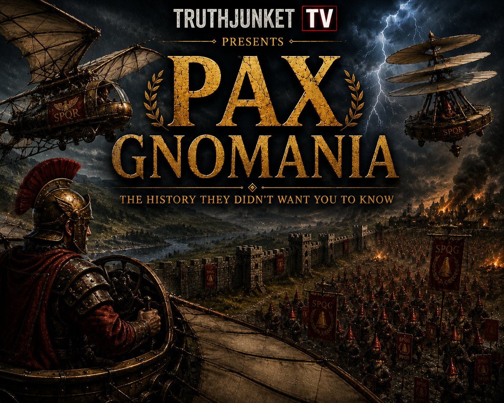

## ▶ [PLAY IT IN YOUR BROWSER][play]

*A TruthJunket TV special.*

Britannia, AD 122. For two hundred years, historians tell us, Rome enjoyed
peace. Historians credit the legions.

**Dr. H. Wolfe** has other ideas.

Tonight on TruthJunket TV, the occult historian of Peter University follows the
record no one was supposed to keep: Hadrian's secret **Ornithopter Corps**,
bronze flying machines built by gnome engineers, and the night the **Red Hat
Legion** came up the white cliffs at Dover. It was the end of the Peace. It went
all the way to the Wall.

*"They had flight in AD 122. We do not. Are we, in fact, going backwards?"*

---

A Castle Killscreen arcade game by Anders & Partners LLC. Free, in your
browser, nothing to install, and nothing leaves the page: no fonts, no
trackers, no outside servers.

You fly an ornithopter above a war you can't win. The Red Hat Legion advances
underneath you and everybody it catches is left behind: villagers, Roman
legionaries, gnome engineers, the garrison goats. You can't stop the war. You
can bring people out of it, one at a time, on the end of a rope.

## How to play

Fly **low** and the end of your rope reaches the stranded. Pass it to their
hands and they grab on and hang. Carry them to the **SAFE** flag (the camp, the
stockade, the ridge, the milecastle) and set them down low. The rope holds one.
Bring out enough before the horn and the front is held.

- **THE RAY**: hold it over a red hat and a beam of light lifts him out of the
  fight. You hover while it works.
- **THE SCREW**: tap it and the ornithopter folds into the bronze aerial screw.
  Fire passes through you and bolts bounce off. It has a short cooldown.
- **LADDER CRATES** drift in now and then. The ladder carries three, and they
  climb up while you hold still. Goats won't climb, so they go on the rope.
- **Every danger warns you first.** A dotted aim line turns **red** before the
  ballista fires. A red lane flashes before a taken thopter crosses it. A ring
  marks where the catapult stone will land.
- **A hit** costs hull, and whoever is on your rope lets go. A short drop they
  walk off. A long fall, they're lost. Three hits and you're shot down.

### Controls

| | Keyboard | Controller |
|---|---|---|
| Fly | arrows or **WASD** | stick / D-pad |
| THE RAY (hold) | **SPACE** or **Z** | **A** |
| THE SCREW | **F**, **X** or **SHIFT** | **B** |
| Start / confirm | **SPACE** or **ENTER** | **A** / **START** |
| Retry the front | **R** | **A** on the retry screen |
| Title | **ESC** | **SELECT** |
| Sound on/off | **M** | |

The game is laid out for a computer screen, 16:9.

## The fronts

The campaign follows the Legion's march from Dover to Hadrian's Wall. Five
fronts are playable now:

1. **THE FALL OF DOVER**: dawn on the white cliffs, the tutorial. The sky is
   still calm.
2. **NOTTINGHAM HOODS**: travellers under the Sherwood canopy, and the Hoods,
   who shoot at anything in the sky.
3. **THE WELSH WASH**: the dam is broken. Legionaries stand in rising water
   under a blood-red sun, with ballista bolts, catapult stones and gliders
   coming at you all at once.
4. **SEGEDUNUM — WALLSEND**: the first section of the Wall. The Legion raises
   scaling ladders along the walkway, and you have to get the garrison down
   before the red hats reach them.
5. **THE WHITE HORSE VALE**: dawn under the chalk horse on the downs. The host
   comes out of the east and catches the Legion in the open, half-way through
   pitching camp, before the fort is up. There are no walls. The catapult, the
   ballista and the cart hold the red hats while they hack through. On the
   march it comes between London and the Welsh Wash.

London, Liverpool, York and Wall sections W2 to W5 show on the map as
**SEALED**. W5 ends with Hadrian and the Gnomean King on top of the Wall.

## Ways to play

- [PLAY][play]: boots like a cabinet. The TruthJunket special runs to the theme
  and any key goes to the title.
- [TITLE][title]: straight to the menu.
- [THE CAMPAIGN][campaign]: the march from Dover.
- [FRONT 1 · DOVER][f1] · [FRONT 2 · NOTTINGHAM][f2] ·
  [FRONT 3 · WELSH WASH][f3] · [FRONT 4 · WALLSEND][f4] ·
  [FRONT 5 · THE WHITE HORSE VALE][f5]: one front on its own,
  starting from its briefing card.
- [CHOOSE A FRONT][select]: the map of the whole march.
- [HOW TO FLY][howto]: the controls card.
- [WATCH IT PLAY][demo]: the autopilot flies Dover.
- [SELF TEST][selftest]: the game checks itself. Every front, every hazard
  telegraph, the rope and ladder rules, and that a competent pilot can win
  and an untouched front fails.

## Status: working build

Playable start to finish across the five fronts, with results, retry and the
campaign map. Still to come:

- **Sound.** The main theme, *Britannia*, plays on the attract and title.
  Weapon clanks, menu sounds and music for each front are on the way. Until
  they arrive the game plays small placeholder blips.
- **The rest of the march.** London, Liverpool, York, Wall sections W2 to W5,
  the climb and the summit duel are designed but not built.
- **Art.** Commissioned art for the friendly gnome engineers, the wall faces and
  the duel is still to come. The green-capped gnomes you rescue now are
  recoloured red-hat figures standing in for it.

## Credits

Created by **Joseph Coleman**, with Claude, ChatGPT, and Blender.
A Castle Killscreen game by Anders & Partners LLC.

Main theme: *Britannia — Theme from PAX GNOMANIA*.

This bundle is built from the `HADRIAN'S ANCIENT AIR FORCE` repo
(`tools/build_pages.py`). Edits go there, not here.

---

RESPEK LOGIC ART UREA

[play]: https://anderspartnersck.github.io/PAXGNOMANIA/
[title]: https://anderspartnersck.github.io/PAXGNOMANIA/?title
[campaign]: https://anderspartnersck.github.io/PAXGNOMANIA/?campaign
[f1]: https://anderspartnersck.github.io/PAXGNOMANIA/?front=1
[f2]: https://anderspartnersck.github.io/PAXGNOMANIA/?front=2
[f3]: https://anderspartnersck.github.io/PAXGNOMANIA/?front=3
[f4]: https://anderspartnersck.github.io/PAXGNOMANIA/?front=4
[f5]: https://anderspartnersck.github.io/PAXGNOMANIA/?front=5
[select]: https://anderspartnersck.github.io/PAXGNOMANIA/?select
[howto]: https://anderspartnersck.github.io/PAXGNOMANIA/?howto
[demo]: https://anderspartnersck.github.io/PAXGNOMANIA/?front=1&demo
[selftest]: https://anderspartnersck.github.io/PAXGNOMANIA/?selftest
